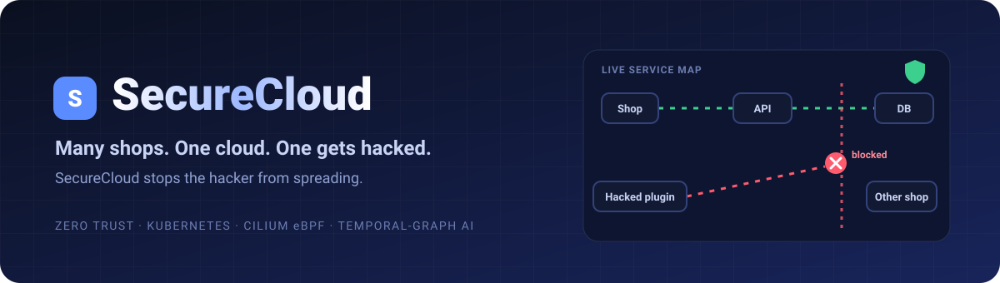
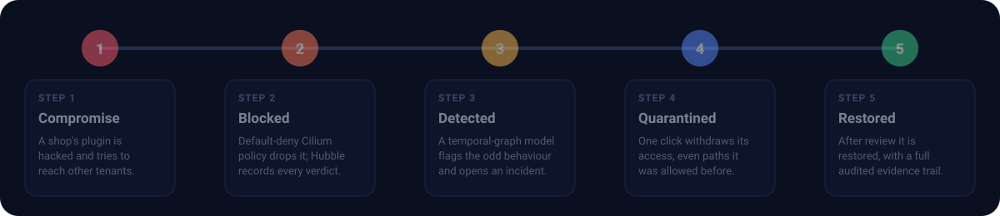
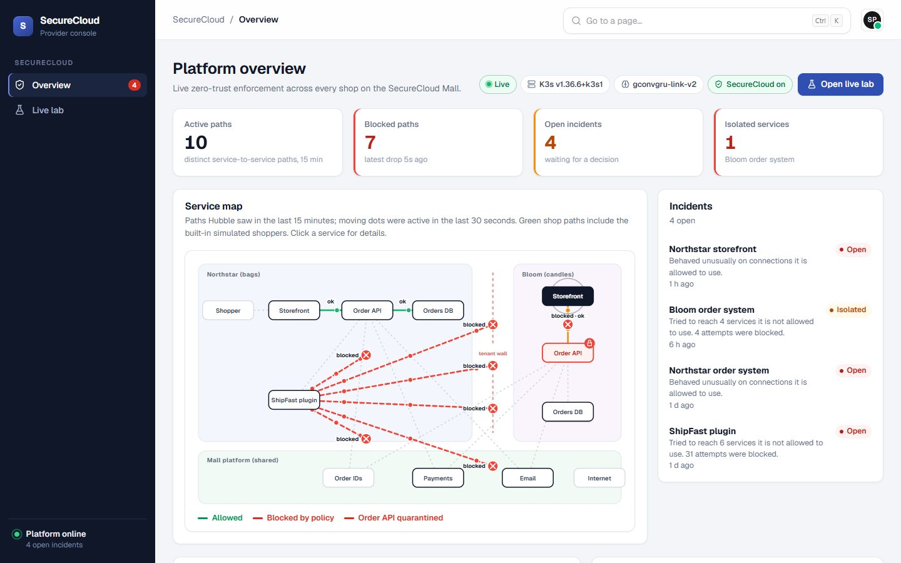
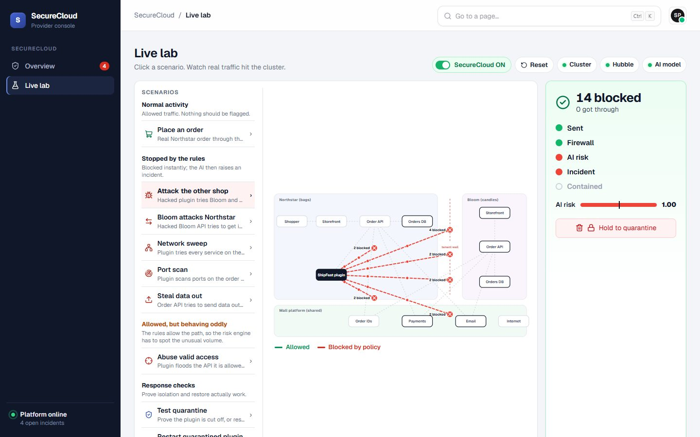
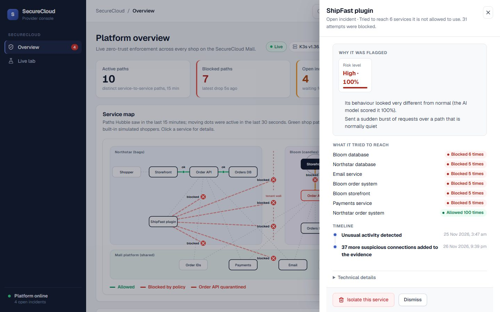
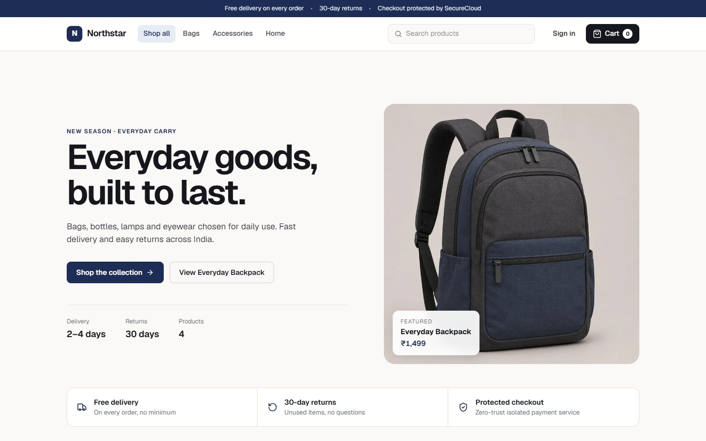

<div align="center">



# SecureCloud: Zero Trust Security Framework for Multi-Tenant Cloud Virtualisation

<a href="https://securecloud-wake-qudb8c.azurewebsites.net">
  
</a>

<p>
  <a href="https://securecloud-wake-qudb8c.azurewebsites.net"></a>
  
  
  
</p>

<p>
  <a href="#-live-demo">Live demo</a> ·
  <a href="#-how-it-works">How it works</a> ·
  <a href="#-screenshots">Screenshots</a> ·
  <a href="#%EF%B8%8F-run-your-own">Run your own</a> ·
  <a href="#%EF%B8%8F-limitations">Limitations</a>
</p>

</div>

An **Azure-like self-service private-cloud prototype on Kubernetes**, with a built-in zero-trust
security plane. Every shop is a tenant in its own isolated namespace behind default-deny policy.
When one is compromised, SecureCloud **blocks** the attacker's lateral movement, **detects** the
behaviour with a temporal-graph model, and **quarantines** the affected workload.

## 🚀 Live demo

<table>
<tr>
<td width="60%">

### **[securecloud-wake-qudb8c.azurewebsites.net](https://securecloud-wake-qudb8c.azurewebsites.net)**

😴 The lab **sleeps when nobody is using it**. Opening the link wakes it: you get a boot screen
for a minute or two, then it forwards you to the live site. It goes back to sleep after
30 minutes without visitors.

</td>
<td>

**🔑 Public guest login**

```text
guest@74-225-145-124.sslip.io
n3iAGrgUVnRjLF3JQg
```

Or just click **Sign in as guest**.

</td>
</tr>
</table>

> [!NOTE]
> The guest login is public on purpose and limited on the server. It can explore the provider
> console, run the attack lab and quarantine or restore **testbed** workloads. It **cannot** remove,
> pause or reconfigure shops, open shops, or see merchants' email addresses. Everyone shares one
> demo, so you may see someone else's attack in progress.

### ⏱️ Try it in two minutes

| | Do this | You'll see |
|:-:|---|---|
| 1️⃣ | Open **[/lab](https://securecloud-wake-qudb8c.azurewebsites.net/lab)** → **Sign in as guest** | 11 attack and response scenarios against a live cluster |
| 2️⃣ | Click **Attack the other shop** | The hacked plugin's packets dropped at the tenant wall, live |
| 3️⃣ | Open **[/admin](https://securecloud-wake-qudb8c.azurewebsites.net/admin)** | The alert, the AI's risk score and the evidence |
| 4️⃣ | Click **Isolate this service** | Its access withdrawn, including paths it was allowed before |
| 5️⃣ | Visit **[Northstar](https://securecloud-wake-qudb8c.azurewebsites.net/northstar/shop)** or **[open a shop](https://securecloud-wake-qudb8c.azurewebsites.net/start)** | Real orders as traffic, and a new tenant provisioned in about 30 s |

## 🧠 How it works



<table>
<tr>
<td width="50%" valign="top">

### 🏬 Self-service cloud
- Merchants **open a shop** from one allowlisted template
- Each shop gets its own **namespace, quota and restricted Pod Security**
- **Pause, resume and remove** are authorised, idempotent and verified against the cluster
- Server-side quota keeps the single-node lab at **5 live shops**

</td>
<td width="50%" valign="top">

### 🛡️ Zero-trust security plane
- **Cilium** enforces default-deny policy between every tenant
- **Hubble** (eBPF) records the verdict on every flow
- A **GConvGRU temporal-graph** link-prediction model scores behaviour, corroborated with policy denials and cross-tenant attempts
- **Quarantine** survives reconciliation and pod replacement; restore is audited

</td>
</tr>
</table>

🧪 The **attack lab** runs synthetic attacks inside the cluster only and scores prevention, detection,
false positives and containment time. A result is never inferred from a timeout: unobserved or
ambiguous outcomes are reported as **inconclusive**.

## 📸 Screenshots

<table>
<tr>
<td width="50%"><p align="center"><b>Provider console</b>: live service map, blocked paths, incidents</p></td>
<td width="50%"><p align="center"><b>Live lab</b>: launch an attack, watch every packet get blocked</p></td>
</tr>
<tr>
<td><p align="center"><b>Incident</b>: why it was flagged and what it tried to reach</p></td>
<td><p align="center"><b>Tenant storefront</b>: a real shop running on the cluster</p></td>
</tr>
</table>

## 🧰 Stack

<p align="center">
  
</p>

<p align="center">K3s · Cilium + Hubble (eBPF) · FastAPI modular monolith · SQLite · PyTorch Geometric · React + Vite + TypeScript · Caddy (HTTPS)</p>

## 🛠️ Run your own

On a fresh **Ubuntu 24.04** VM (2 vCPU, 4 GB) with ports 80 and 443 open:

```bash
curl -fsSL https://raw.githubusercontent.com/GIRISHRV/securecloud/main/deploy/install.sh | sudo bash
```

✅ Installs Kubernetes, Cilium and Hubble · 🏗️ builds and provisions the testbed shops ·
🔐 gets an HTTPS certificate for `<your-ip>.sslip.io` · 🔑 prints generated logins.
Re-run it to update. Details, the sleep/wake front door and the local Windows + WSL lab are in
**[docs/DEPLOYMENT.md](docs/DEPLOYMENT.md)**.

## ⚠️ Limitations

- 📦 Containers stand in for virtual machines; this is a **single-node lab** with **synthetic** attack traffic.
- 🧱 Namespace isolation is soft multi-tenancy and **does not replace** a cloud provider's own tenant isolation.
- 🎯 The project addresses **post-compromise lateral movement** between organisation-managed workloads; it does not claim that public clouds expose one customer to another.

<div align="center">
<sub>Built as a final-year project · a self-service private cloud with zero trust built in</sub>
</div>
